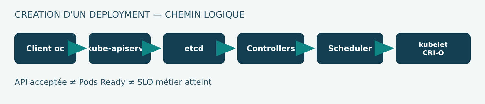

# 01 — Anatomie d'une requête OpenShift : du client au control plane

**Volume 02 · DRAFT · Référence documentaire OCP 4.22 / Kubernetes 1.35.**  
**Preuve : PUBLIC_VERIFIED pour les mécanismes documentés. Aucun nouveau test CRC.**

## Objectifs

Comprendre ce que réalise chaque composant du plan de contrôle, expliquer pourquoi créer un Deployment ne signifie pas obtenir une application Ready, distinguer les refus d'authentification, d'autorisation et d'admission, et concevoir les premières étapes d'un diagnostic de l'API.

## 1. Un control plane est un système, pas seulement un nœud

| Composant | Rôle fondamental | Observation opérationnelle |
|---|---|---|
| kube-apiserver | Exposition de l'API Kubernetes et validation des demandes | Codes de réponse, latence, disponibilité |
| etcd | Conservation cohérente de l'état API | Quorum, membres, latence de persistance |
| kube-controller-manager | Exécution des contrôleurs Kubernetes standard | Ressources filles, Events, convergence |
| kube-scheduler | Sélection des nœuds pour les Pods non assignés | FailedScheduling et paramètres de placement |
| OpenShift API server | Gestion d'API propres à OpenShift | Disponibilité et cohérence d'API OpenShift |
| CVO | Pilotage du payload de release et ClusterOperators | Conditions de ClusterVersion |
| MCO | Configuration et mise à jour de systèmes RHCOS | MachineConfigPools, progression et dégradation |
| kubelet et CRI-O | Exécution de conteneurs sur les nœuds après placement | Status Pod, runtime et événements |

OCP 4.22 utilise Kubernetes 1.35 et CRI-O. Pour le système des nœuds, les sources Red Hat 4.22 sont **contradictoires** : release notes indiquant RHCOS control plane/compute, guides Architecture/installation évoquant certains compute nodes RHEL. Le choix OS worker doit être vérifié dans les guides propres au mode d'installation et la matrice de support Red Hat. Voir l'erratum de cette édition.

## 2. Chemin de la création d'un Deployment

L'ingénieur transmet une intention à l'API. La réponse HTTP positive de l'API indique que cette intention a été acceptée et persistée, pas que l'application traite déjà les transactions.

Séquence pédagogique :

1. Le client oc contacte l'endpoint API en HTTPS.
2. Le réseau et, selon topologie, le load balancer acheminent vers un kube-apiserver.
3. Authentification du sujet, puis autorisation et admission de l'objet.
4. Validation de la ressource et persistance de son état dans etcd.
5. Le Deployment controller observe le Deployment et ajuste un ReplicaSet.
6. Le ReplicaSet controller observe le ReplicaSet et ajuste des Pods.
7. Le scheduler choisit les nœuds des Pods non affectés.
8. Le kubelet observe les Pods assignés et demande à CRI-O de préparer leur exécution.
9. Les conditions Pod, ReplicaSet et Deployment reflètent ensuite l'état observé.
10. Le propriétaire métier évalue séparément les SLI de la transaction.

Les étapes 5 à 9 ne forment pas un programme séquentiel bloquant; elles représentent plusieurs boucles de contrôle asynchrones. Un Pod peut rester Pending, ou bien un container peut ne pas devenir Ready.

## 3. Le pipeline d'une demande API

Trois notions doivent être séparées :

- **Authentification** : établir l'identité technique du demandeur.
- **Autorisation** : déterminer si ce sujet peut réaliser le verbe demandé sur cette ressource et dans ce contexte.
- **Admission** : appliquer les validations/mutations supplémentaires, par exemple SCC, PSA, webhooks, LimitRange et politiques de quota selon configuration.

Un refus 403 lié à l'autorisation signifie qu'un serveur a pu traiter la requête et la refuser. Ce n'est pas, à lui seul, la preuve d'un control plane indisponible.

Dans une création de Pod, une autorisation RBAC positive ne suffit pas à garantir l'admission : l'objet peut encore être refusé pour profil de sécurité, quota ou validation webhook.

## 4. Persistance et événements d'état

Le kube-apiserver est le point d'entrée autorisé des changements; etcd conserve les ressources de l'API du cluster. Les contrôleurs surveillent ensuite les objets et reconcilient leur état.

Un changement de spec n'est pas une preuve de changement effectif des processus. Le statut peut avoir du retard, et le champ observedGeneration ne doit être interprété que selon le contrat de la ressource concernée.

Il faut aussi distinguer :

| Champ | Signification | Erreur courante |
|---|---|---|
| metadata.uid | Identité persistante d'un objet pendant sa vie | Confondre même nom et même objet |
| metadata.resourceVersion | Version opaque utilisée pour la concurrence et les observations | La traiter comme un timestamp |
| metadata.generation | Évolution de l'intention selon le type API | La confondre avec un nombre de retries |
| status / Conditions | Observations et raisons signalées | Conclure à un état réel sans vérifier sa fraîcheur |

## 5. List/watch et cohérence de la vue

Les clients de contrôleurs utilisent couramment un LIST initial suivi d'un WATCH des changements. Les caches peuvent avoir un retard transitoire. Les interruptions de watch, le vieillissement des versions historiques et le renouvellement des connexions impliquent une gestion de reprise.

Un changement accepté par l'API mais non encore présent dans un cache n'implique donc pas automatiquement une corruption etcd. Le diagnostic doit comparer plusieurs niveaux : réponse API, génération de l'objet, événements du contrôleur et statut des dépendances.

## 6. Qu'est-ce qu'une API hautement disponible ?

La disponibilité réelle repose sur plusieurs domaines :

- redondance des instances API et santé des certificats;
- endpoint DNS/LB joignable;
- disponibilité du quorum etcd;
- réseaux et stockage du control plane;
- capacité des nœuds de contrôle et de leurs ressources critiques;
- gestion du cycle de vie des certificats et updates.

La documentation OCP 4.22 indique trois nœuds de control plane pour les architectures de production standard, avec certaines topologies bare metal allant jusqu'à cinq. Il ne faut pas interpréter ce fait comme une autorisation universelle d'agrandir le control plane sans procédure supportée.

## 7. Gestionnaires actifs et élection de leader

kube-controller-manager et kube-scheduler utilisent des mécanismes de leader election dans des configurations HA afin de limiter l'activité concurrente sur les mêmes responsabilités. Les objets Kubernetes Lease sont une brique de coordination.

Ce mécanisme ne garantit pas l'absence de double effet dans une application qui appelle un système externe. Un Operator bancaire doit concevoir séparément idempotency keys, retries et éventuellement fencing pour les opérations métier.

## 8. Lecture seule : premiers contrôles

Dans un cluster OpenShift autorisé, relever :

- la version client/cluster et l'état de ClusterVersion ;
- les conditions Available, Progressing et Degraded des ClusterOperators ;
- la santé des nœuds, leurs domaines de panne et leur rôle ;
- l'état des MachineConfigPools ;
- les Pods du plan de contrôle visibles dans les namespaces système ;
- les événements associés aux workloads impactés.

Exemples de commandes en lecture seule :

    oc version
    oc get clusterversion
    oc get clusteroperators
    oc get nodes -o wide
    oc get machineconfigpools
    oc -n openshift-etcd get pods
    oc -n openshift-kube-apiserver get pods

Des erreurs RBAC peuvent limiter l'observation. N'essayez pas d'obtenir une session privilégiée ou d'éditer le control plane pour un exercice de diagnostic.

## 9. Lecture de symptômes

| Symptôme | Pistes à départager |
|---|---|
| Échec de négociation TLS de l'API | DNS, load balancer, certificat, CA, endpoint |
| API renvoie Forbidden | Sujet, verbes RBAC, namespace, ressource |
| Pod refusé à la création | Admission SCC/PSA, webhook, quota, LimitRange |
| Pod Pending sans affectation de nœud | Scheduler, requests, taints, PVC et topology |
| Pod assigné mais ImagePullBackOff | Référence d'image, registre, réseau, secret de pull |
| Deployment créé, replicas non prêts | Contrôleurs, scheduler, kubelet, probes |
| CVO Progressing anormalement | Version, ClusterOperators, MCO et dépendances |

## 10. Questions d'architecte

1. Pourquoi le kube-apiserver ne lance-t-il pas lui-même les containers ?
2. Quelle différence entre une écriture API acceptée et une condition Ready ?
3. Pourquoi etcd n'est-il pas une base de données applicative ?
4. Quelles couches doivent être disponibles pour une API réellement hautement disponible ?
5. Un rôle RBAC suffisant garantit-il l'admission d'un Pod ?
6. Pourquoi le scheduler n'est-il pas responsable de télécharger les images ?
7. Comment distinguer panne d'API, problème d'authentification et manque de droits ?

## Sources officielles

- [Red Hat — OCP 4.22 Architecture](https://docs.redhat.com/en/documentation/openshift_container_platform/4.22/html/architecture/architecture)
- [Red Hat — OCP 4.22 Control plane](https://docs.redhat.com/en/documentation/openshift_container_platform/4.22/html/architecture/control-plane)
- [Red Hat — OCP 4.22 Release notes](https://docs.redhat.com/en/documentation/openshift_container_platform/4.22/html/release_notes/ocp-4-22-release-notes)
- [Kubernetes — Cluster architecture](https://kubernetes.io/docs/concepts/architecture/)
- [Kubernetes — API concepts](https://kubernetes.io/docs/reference/using-api/api-concepts/)
- [Kubernetes — Leases](https://kubernetes.io/docs/concepts/architecture/leases/)

**Limite de preuve :** chapitre documentaire ; aucun nouveau test sur un cluster réel pendant cette rédaction.

## 11. Internes de l'API : lecture, écriture, watch et erreurs

### 11.1 Anatomie d'une requête WRITE

La séquence suivante doit être comprise **sans confondre admission et réconciliation** :

1. Le client négocie TLS et fournit ses credentials au serveur API.
2. L'authentification produit une identité utilisateur, ses groupes et informations additionnelles.
3. L'autorisation évalue le verbe, la ressource, le namespace et, selon l'opération, le sous-objet.
4. Les contrôles d'admission applicables à l'opération écrite évaluent puis éventuellement modifient la demande.
5. La validation de schema et les contraintes du type doivent être satisfaites.
6. La nouvelle représentation est persistée via le système de stockage de l'API.
7. L'API retourne un objet et des métadonnées de version.
8. Les watches/informers rendent progressivement cette modification visible aux contrôleurs.
9. Le contrôleur propriétaire écrit l'état désiré des ressources filles; les kubelets produisent les statuts.
10. L'utilisateur doit enfin observer une condition opérationnelle et le comportement métier.

Un HTTP 201 Created ne signifie **pas** que le Pod est prêt. L'API peut valider des objets dont la spec est admissible, mais qui ne seront pas schedulables en raison de ressources futures indisponibles. Le statut doit donc être associé à une **fenêtre temporelle** et à la génération de spec qu'il décrit.

### 11.2 Anatomie d'une requête LIST/WATCH

Un client qui affiche \`oc get pods -w\` reçoit un état puis des évolutions selon les mécanismes list/watch de l'API. Pour un opérateur Go, un SharedInformer maintient une cache d'objets alimentée par des événements. Cette cache est utile, mais ne représente pas forcément la dernière écriture persistée au moment exact où un reconcile lit l'objet.

Le \`metadata.resourceVersion\` est **opaque**. Il faut le passer au serveur API comme défini par le protocole, non le décoder comme un entier global ou un timestamp. Un watch qui retourne une expiration de version historique exige une nouvelle synchronisation conforme à la bibliothèque du client. Les bookmarks ne constituent pas des « checkpoints de transaction métier ».

### 11.3 Concurrence optimiste, conflit et retry

Deux contrôleurs peuvent lire le même objet à la même version, puis tenter de mettre à jour ses champs. Les APIs Kubernetes utilisent des mécanismes de concurrence et de propriété, dont les conditions de ressource et Server-Side Apply. Un conflit n'est pas une invitation à réécrire brutalement la ressource : il peut signifier qu'un autre acteur possède cette portion de l'état.

Pour un retry sûr :
- relire la version courante;
- reconstruire l'intention sur l'état le plus récent;
- ne pas modifier les champs appartenant à un autre contrôleur;
- borner les reprises avec backoff;
- publier Conditions/Events qui rendent la contention visible.

Un \`RetryOnConflict\` côté code Go protège une séquence de mise à jour d'un objet sous ses préconditions. Il ne peut pas rendre automatiquement **idempotent** un transfert bancaire, un envoi MQ ou une opération sur une API externe.

## 12. API Priority and Fairness : disponibilité sous pression

L'API Kubernetes peut recevoir des requêtes d'humains, kubelets, controllers, Operators et outils d'automatisation. Sous pression, traiter chaque requête sans distinction peut exposer les opérations vitales à une saturation par des clients non critiques.

Le mécanisme **API Priority and Fairness (APF)** applique des règles de classement et de limitation de concurrence pour certaines requêtes, selon la configuration des objets FlowSchema et PriorityLevelConfiguration. Il ne crée pas de capacité physique et ne protège pas les appels extérieurs à l'API Kubernetes.

Inspection read-only sur cluster autorisé :

~~~bash
oc get flowschemas.flowcontrol.apiserver.k8s.io
oc get prioritylevelconfigurations.flowcontrol.apiserver.k8s.io
oc get --raw /readyz
~~~

La dernière commande interroge un endpoint de santé; son accès et sa disponibilité peuvent varier selon permissions et configuration. Une réponse positive de \`readyz\` vérifie un contrat de readiness **de l'API**, pas la transaction métier complète.

### Incident hypothétique : contrôleur trop bavard

Un Operator à bug effectue un LIST exhaustif toutes les 100 ms. Ses demandes provoquent de la charge API disproportionnée. Le diagnostic doit corréler les métriques de requêtes par client/ressource (selon disponibilité), les erreurs de throttling et la latence des opérations critiques. Le correctif architectural consiste à utiliser correctement les watches/caches, à ne pas faire de polling agressif et à borner les retries — pas à augmenter arbitrairement les ressources de kube-apiserver.

## 13. Certificats et chemins API : identité versus accessibilité

Un client qui échoue avec \`x509: certificate signed by unknown authority\` a un problème de chaîne de confiance ou de configuration TLS. Ce symptôme n'est pas équivalent à un timeout TCP. Les stratégies de diagnostic divergent :

| Phase | Symptôme indicatif | Contrôle |
|---|---|---|
| DNS | Nom API non résolu | DNS et endpoint utilisé |
| TCP | Connection refused / timeout | LB, firewall, route réseau |
| TLS | Certificat non fiable/expiré, SAN incorrect | Chaîne CA et nom SNI |
| Authentification | HTTP 401 | Token, cert utilisateur, horloge, identité |
| Autorisation | HTTP 403 | RBAC, verbe, namespace, sujet |
| Admission | Erreur de création/validation | SCC, PSA, webhook, quota, message API |
| Reconcilation | Objet créé mais non Ready | Contrôleurs, scheduling, runtime |

Ne jamais placer un certificat ou kubeconfig réel dans les annexes du Masterbook. La commande \`--insecure-skip-tls-verify\` contourne une barrière d'authenticité et ne constitue pas une correction supportable.

## 14. Protocole de preuve pour une API lente

**Hypothèse H1 :** le réseau externe ralentit; **H2 :** les contrôles d'admission ralentissent; **H3 :** etcd a une latence d'écriture élevée; **H4 :** le client produit trop de requêtes.

Un protocole autorisé suit :
1. enregistrer l'heure et le point de mesure;
2. comparer accès API depuis plusieurs réseaux autorisés;
3. comparer requêtes simples GET et écritures contrôlées **sur un cluster de test**, pas sur CRC partagé;
4. examiner les métriques API, l'admission et la santé etcd;
5. corréler la période avec update CVO/MCO et déploiements d'Operators;
6. séparer symptômes de requêtes utilisateur et événements des controllers;
7. documenter **ce qui n'est pas observé** lorsque RBAC ou monitoring restreint la visibilité.

**Résultat attendu :** une classification argumentée et datée, pas un redémarrage d'etcd sous incertitude.

## Références d'approfondissement

- [Kubernetes — API Priority and Fairness](https://kubernetes.io/docs/concepts/cluster-administration/flow-control/)
- [Kubernetes — API Concepts](https://kubernetes.io/docs/reference/using-api/api-concepts/)
- [Kubernetes — Controllers](https://kubernetes.io/docs/concepts/architecture/controller/)
- [Red Hat OpenShift 4.22 — API configuration](https://docs.redhat.com/en/documentation/openshift_container_platform/4.22/html/config_apis/config-apis)
