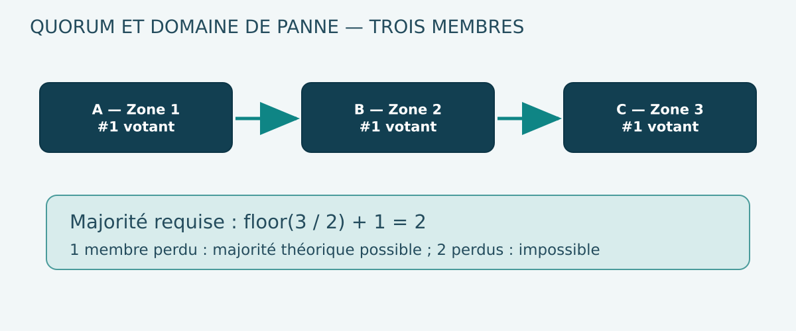

# 02 — etcd : Raft, quorum, sauvegarde et reprise du control plane

**Volume 02 · DRAFT · Version cible OCP 4.22**  
**Source primaire : documentation Red Hat Backup & Restore ; aucune opération mutatrice exécutée.**

## Objectifs

Comprendre pourquoi etcd est critique dans OpenShift, expliquer le calcul du quorum, différencier une majorité absente d'une simple panne de Pod, et connaître les contraintes Red Hat de sauvegarde/restauration avant de concevoir un runbook de reprise.

## 1. Ce que stocke etcd

etcd est la base clé/valeur cohérente sur laquelle Kubernetes et OpenShift persistent l'état des objets API. Deployments, ConfigMaps, Secrets, CRDs et autres ressources du cluster contribuent à cet état.

Ce n'est **pas** une base transactionnelle métier et ce n'est **pas** un remplacement de PostgreSQL, MongoDB ou du journal d'événements de l'application. Les garanties du control plane ne garantissent pas la cohérence fonctionnelle des systèmes externes.

Le kube-apiserver est normalement le point de passage autorisé pour les clients Kubernetes. Accéder directement à etcd avec des certificats privilégiés est une opération de support spécifique à contrôler rigoureusement.

## 2. Quorum et Raft

Les membres votants d'un cluster etcd doivent former une majorité pour obtenir les garanties attendues du protocole de consensus.

La formule pédagogique est :

    quorum(N) = floor(N / 2) + 1

| Membres votants N | Majorité nécessaire | Membres perdus tolérés |
|---:|---:|---:|
| 1 | 1 | 0 |
| 3 | 2 | 1 |
| 4 | 3 | 1 |
| 5 | 3 | 2 |

Ces calculs ne constituent ni une recommandation de modifier un control plane en production ni une preuve de topologie supportée par Red Hat. L'architecture OCP 4.22 a ses propres règles d'installation et de modification de membres.

### 2.1 Pourquoi quatre membres ne tolèrent pas deux pannes

Le quorum passe de deux membres pour un groupe de trois à trois pour un groupe de quatre. Un groupe de quatre tolère donc une perte de membre, comme un groupe de trois. Ajouter des membres ne réduit pas mécaniquement le risque opérationnel : cela augmente les contraintes de réseau, de disques et de maintenance.

### 2.2 Partition réseau 2–1 dans un groupe de trois

Si A et B restent connectés tandis que C est isolé, A/B constituent une majorité potentiellement apte à poursuivre les écritures. C seul ne constitue pas le quorum. Une telle partition évite de traiter deux états divergents comme des sources concurrentes de vérité.

Cela suppose que les deux membres majoritaires disposent également d'un stockage et d'un réseau en état correct; une majorité numérique n'assure pas une faible latence.

## 3. Latence disque, réseau et stabilité du leader

etcd est sensible à la performance et à la régularité des accès de stockage ainsi qu'à la communication entre membres. Une latence disque dégradée peut ralentir les écritures et les réponses de l'API; les changements de leader peuvent amplifier les perturbations.

Une analyse doit distinguer :
- réseau utilisateur vers endpoint API;
- latence du kube-apiserver;
- disponibilité et quorum etcd;
- latence de commit disque des membres;
- saturation CPU/mémoire ou I/O de nœuds de contrôle;
- difficultés d'autorisation/admission sans panne d'etcd.

Redémarrer des Pods métiers ne résout pas un quorum etcd absent; cela peut au contraire augmenter la pression API.

## 4. Observations et limites

| Observation | Hypothèse possible | Pourquoi la conclusion reste incertaine |
|---|---|---|
| ClusterOperator etcd Degraded | Membres, certificats, stockage ou réseau | La raison doit être examinée |
| API lente pour plusieurs types d'objet | Saturation API/etcd | DNS/LB ou admission peuvent aussi ralentir |
| Un Pod etcd non Ready | Membre défaillant | Un Pod Running n'établit pas la majorité |
| Écriture API refusée | Quorum, admission ou droits | Examiner code/réponse exacte |
| Problème après upgrade | Version/configuration/ressources | Nécessite chronologie et préflight de version |

Il faut préserver horodatages, conditions, événements et évolution du trafic. Un signal isolé n'est pas une preuve de causalité.

## 5. Sauvegarder le control plane, pas seulement un fichier

Le guide Red Hat OCP 4.22 traite le backup d'etcd avec snapshot et ressources associées aux static Pods. Le processus peut être manuel ou automatisé selon les fonctionnalités/configurations documentées.

Points essentiels de la documentation 4.22 :

1. Sauvegarder régulièrement et conserver une copie sécurisée hors du cluster OpenShift.
2. Sauvegarder avant de réaliser une mise à jour de cluster.
3. Planifier, si possible, hors charge de pointe car le snapshot a un coût I/O.
4. Ne pas créer le premier backup avant la première rotation des certificats, documentée à environ **24 heures après l'installation**.
5. Pour un retour à un état antérieur, utiliser une sauvegarde correspondant à **la même version z-stream** que le cluster de restauration, conformément à la procédure Red Hat.
6. Conserver ensemble le snapshot et les ressources de static Pods requises par le runbook.

Une sauvegarde de l'API peut inclure des Secrets et d'autres objets confidentiels. Les archives doivent être traitées comme sensibles; ni le backup, ni des certificats, ni des clés de contrôle ne doivent être placés dans un GitHub public.

### 5.1 Sauvegarde présente ne signifie pas reprise prouvée

Une sauvegarde exploitable exige des contrôles :
- emplacement indépendant du domaine de panne visé;
- chiffrement, droits, inventaire et durée de rétention;
- correspondance versions et ressources requises;
- capacité à sélectionner un point de restauration pertinent;
- procédure testée sur un environnement de reprise autorisé;
- mesures de RPO/RTO et vérification de cohérence après redémarrage.

Le simple succès d'une commande de snapshot ne valide pas tous ces contrôles.

## 6. Restauration d'état et restauration de quorum : deux problèmes

**Restauration à un état antérieur :** reconstruire un état de control plane à partir d'un snapshot compatible. La procédure doit gérer les membres etcd, les static Pods, la version et les objets recréés. Elle peut perdre les changements intervenus depuis la sauvegarde.

**Quorum recovery :** si la majorité a été perdue, le guide 4.22 décrit une procédure de restauration de quorum reposant notamment sur un hôte de récupération. Ce scénario peut parfois exploiter des données locales sans disposer d'un snapshot préalable, mais il présente des risques importants de perte de données ou de split-brain si le mauvais état est sélectionné.

Ces opérations requièrent une procédure officielle, des administrateurs qualifiés, des contrôles de cohérence et un accord explicite. Elles sont **interdites dans les laboratoires de base de ce livre**.

## 7. Exercice sur papier : trois scénarios

### Scénario A — un membre indisponible

Cluster fictif de trois membres A, B et C. C cesse de répondre, A et B restent stables : la majorité 2/3 peut subsister. L'objectif opérationnel est de préserver A/B, diagnostiquer C et restaurer la redondance selon le support.

### Scénario B — deux membres indisponibles

Seul A demeure visible : 1/3 ne forme pas un quorum. Le problème n'est pas résolu en augmentant les replicas des applications. Il faut qualifier la situation du control plane, conserver les preuves et consulter la procédure officielle appropriée.

### Scénario C — majorité visible, latence importante

Les trois membres répondent mais la latence disque du leader augmente fortement. La majorité subsiste; la qualité de service peut néanmoins se dégrader. Il faut mesurer I/O, réseau entre membres, erreurs du kube-apiserver et tendances de latence.

### Corrigé commun

Dans aucun cas il n'est légitime de supprimer les répertoires etcd, de modifier l'appartenance des membres ou de forcer un restore pour « voir si cela fonctionne ». Le protocole de reprise dépend de la cause et de l'état réellement disponibles.

## 8. Atelier read-only sur cluster autorisé

    oc get clusterversion
    oc get clusteroperator/etcd
    oc get clusteroperator/kube-apiserver
    oc -n openshift-etcd get pods
    oc get nodes -o wide
    oc get machineconfigpools

Ces commandes ne révèlent pas le quorum détaillé à elles seules et peuvent être refusées par RBAC. Leur sortie est une première vue, non un diagnostic complet. Aucun mot de passe, kubeconfig, certificat ou snapshot n'est à extraire.

## 9. ADR d'architecture et continuité

| Dimension | Décision attendue | Preuve |
|---|---|---|
| Topologie | Control plane supporté, domaines de panne | Plans d'installation et validation |
| Stockage | Performance/latence, supportabilité | Métriques et tests de dégradation |
| Sauvegarde | Fréquence, emplacement, chiffrement | Historique et contrôle d'accès |
| Compatibilité | Version z-stream et procédures | Matrice de versions |
| Restore | Responsable, ordonnancement, préflight | Drill en environnement dédié |
| RTO/RPO | Objectifs approuvés, temps mesurés | Mesures d'exercice |
| Sécurité | Secrets, clés, certificats et archives | Audit et contrôle de confidentialité |

Le control plane restauré ne valide pas automatiquement la cohérence des bases de données et files de messages des applications; les domaines de reprise doivent être documentés séparément.

## 10. Questions d'entretien

1. Pourquoi la majorité de trois membres est-elle deux et non trois ?
2. Combien de membres un cluster de cinq peut-il perdre ?
3. Pourquoi un groupe de quatre n'améliore-t-il pas la tolérance à deux pannes ?
4. Comment distinguer une erreur RBAC d'une perte de quorum ?
5. Quelle contrainte z-stream la documentation 4.22 impose-t-elle au restore ?
6. Quelles données sensibles peuvent se trouver dans une sauvegarde d'etcd ?
7. Pourquoi un snapshot ne valide-t-il pas un PRA ?
8. Quand la restauration de quorum est-elle différente d'une restauration d'état antérieur ?

## Références

- [Red Hat — Backup and restore control plane, OCP 4.22](https://docs.redhat.com/en/documentation/openshift_container_platform/4.22/html/backup_and_restore/control-plane-backup-and-restore)
- [Red Hat — Architecture OCP 4.22](https://docs.redhat.com/en/documentation/openshift_container_platform/4.22/html/architecture/architecture)
- [Kubernetes — Cluster Architecture](https://kubernetes.io/docs/concepts/architecture/)
- [etcd — Documentation officielle](https://etcd.io/docs/)

**Limite : aucun test de sauvegarde/restauration, de perte de quorum ni d'accès privilégié à etcd n'a été réalisé sur le CRC.**

## 11. Raft en détail : term, log index et commit

Le modèle Raft fait intervenir des **terms** (époques logiques d'élection), un leader courant, des followers et un journal répliqué. Chaque entrée porte un index dans le journal et appartient à un term. Les machines partagent un contrat de majorité, pas une horloge transactionnelle globale.

Séquence conceptuelle d'une écriture :
1. Un client soumet la modification au service etcd.
2. Le leader compose l'entrée à ajouter au journal.
3. Le leader propage cette entrée à ses followers.
4. Lorsque les conditions de majorité et de sécurité du protocole sont satisfaites, l'entrée peut être considérée comme committed.
5. Le système applique les changements dans l'ordre défini et peut répondre au client.
6. Un follower isolé doit rattraper son retard après sa reconnexion selon le mécanisme approprié.

~~~mermaid
sequenceDiagram
  participant API as kube-apiserver
  participant A as etcd A, leader
  participant B as etcd B, follower
  participant C as etcd C, follower
  API->>A: Put objet
  A->>B: AppendEntries
  A->>C: AppendEntries
  B-->>A: ack durable selon protocole
  A->>A: Commit quand majorité acquise
  A-->>API: succès de l'écriture
~~~

Ce schéma ne représente pas chaque message de Raft ni les optimisations d'etcd. Il illustre pourquoi une majorité et la latence réseau/disque sont indispensables à une écriture stable.

### 11.1 Term n'est pas une date; index n'est pas une latence

On ne peut pas déduire le délai de commit d'une différence d'index. Un term supérieur peut indiquer une nouvelle élection; cela ne signifie pas nécessairement qu'une donnée a été perdue. Une augmentation fréquente de termes/élections peut toutefois être un signal de stabilité à étudier avec les métriques, les logs et les conditions.

### 11.2 Quorum et scénario de domaine de panne

Trois membres \`A, B, C\` répartis sur trois zones autorisent théoriquement la perte d'une zone, car deux votants restent présents. Trois membres dont \`A\` et \`B\` partagent la même alimentation n'offrent **pas** cette propriété face à la panne de cette alimentation.

La tolérance à une panne n'est donc **pas** seulement \`floor((N-1)/2)\`; elle doit être recalculée pour chaque domaine de panne corrélé (zone, rack, storage, réseau et management).

## 12. Compaction, defragmentation et quota backend : trois sujets séparés

etcd conserve un historique de révisions utilisé notamment par les watches. La **compaction** supprime d'anciennes révisions devenues inutiles; elle n'est pas synonyme de récupération immédiate d'espace physique dans tous les cas. La **défragmentation** réorganise l'espace de la base pour permettre une récupération de taille du fichier backend, selon les procédures supportées.

Le **quota de stockage backend** limite l'augmentation de la base. Une base proche de son quota peut compromettre les écritures API même si certains Pods restent Running.

Il serait dangereux d'exécuter \`etcdctl compact\`, \`defrag\` ou des manipulations de quota depuis ce livre :
- elles utilisent des accès privilégiés;
- elles peuvent affecter performance et disponibilité;
- elles exigent un mode opératoire précis et un ordre de traitement supportés par Red Hat;
- elles nécessitent des sauvegardes et des mesures pré/post.

Le Masterbook les explique pour le diagnostic, pas comme procédures génériques d'intervention.

### 12.1 Symptômes qui se ressemblent

| Indice | Cause possible | Pourquoi une vérification supplémentaire est nécessaire |
|---|---|---|
| API slow | Disque etcd lent | Webhook ou LB peuvent aussi retarder |
| Watch expiré (410 Gone) | History compaction normale | Ne signifie pas qu'etcd est corrompu |
| Base etcd volumineuse | Objets et historiques accumulés | Taille seule ne prouve pas une panne |
| Leader changes fréquents | I/O, réseau, horloges, ressources | Corréler avec Events/métriques |
| Failed requests lors d'un upgrade | API, etcd, CVO, admission | Identifier la frontière causale |

## 13. Comparer snapshot de control plane et sauvegarde métier

Une archive etcd couvre le **plan API du cluster**, pas nécessairement les données sur les PV des workloads. Une base PostgreSQL ou un broker MQ peuvent poursuivre leurs activités avec leurs propres journaux et protocoles de réplication.

Le PRA doit donc synchroniser plusieurs domaines de reprise :
- **control plane** : objets Kubernetes, versions, certificats et backup etcd;
- **infrastructure** : machines, volumes, réseaux et adresses;
- **application** : artefacts, manifests, secrets et identity;
- **données métier** : données et WAL, backups, tests d'intégrité et RPO;
- **événementiel** : offsets/acquittements, replay, idempotency keys et traitement des doublons.

Un restore du snapshot etcd sans test de réconciliation avec les volumes réellement disponibles peut reconstituer des PVC pointant vers un stockage disparu. Il peut aussi faire réapparaître des versions d'objets qui ne correspondent plus aux déploiements et credentials externes.

### 13.1 Tableau de compatibilité de reprise

| Élément | Validation avant restauration | Risque |
|---|---|---|
| Version OCP z-stream | Concordance suivant procédure 4.22 | État non supporté |
| Snapshot et static Pods | Jeu de sauvegarde cohérent complet | Impossibilité de reconstruction |
| PKI | Certificats/CA sécurisés et valides | API inaccessible |
| Matériel / topologie | Machines et stockage disponibles | Quorum / volume non remontable |
| Applications | Versions et contrats de schéma compatibles | Erreurs métier |
| Données | RPO, cohérence, intégrité | Perte ou duplication |
| Réseau | VIP/LB/DNS/IP actualisés | Clients ne rejoignent pas API |

## 14. Discussion de sûreté : pourquoi ne pas promouvoir n'importe quel membre

En cas de quorum perdu, choisir un ancien membre doté d'un état incomplet peut conduire à perdre des écritures non répliquées. Dans un SI réglementé, cette différence peut toucher les traces administratives, secrets, ressources et générations des workloads.

Un runbook réel demande une expertise OpenShift, les procédures de support de la version précise, la chronologie et la conservation des données. **Il est exclu de simuler une perte de quorum sur le CRC partagé.**

## 15. Exercice de capacité : estimer l'effet d'un disque lent (papier)

Cas fictif :
- une opération etcd nécessite des écritures durables;
- latence disque médiane initiale 2 ms, p99 15 ms;
- après saturation, médiane 20 ms, p99 150 ms;
- le nombre de membres reste 3 et tous répondent au ping.

**Question :** le quorum est-il mathématiquement perdu ? Non. Les membres sont présents mais les temps de transaction peuvent augmenter fortement. Les utilisateurs peuvent voir des erreurs d'API alors que la topologie de consensus continue d'exister.

**Question :** peut-on extrapoler le p99 API = p99 disque ? Non. Les communications inter-membres, files d'attente, sérialisation, hooks et séquencement d'opérations contribuent à la latence finale.

La mesure du service doit donc rester indépendante du calcul de majorité.

## Références complémentaires

- [etcd — Documentation du consensus Raft et de la maintenance](https://etcd.io/docs/)
- [Red Hat OpenShift 4.22 — etcd](https://docs.redhat.com/en/documentation/openshift_container_platform/4.22/html/etcd/index)
- [Red Hat — Control plane backup and restore 4.22](https://docs.redhat.com/en/documentation/openshift_container_platform/4.22/html/backup_and_restore/control-plane-backup-and-restore)

## 16. Vérification documentaire — compatibilité des sauvegardes

Le guide [OCP 4.22 : contrôle de sauvegarde/restauration](https://docs.redhat.com/en/documentation/openshift_container_platform/4.22/html/backup_and_restore/control-plane-backup-and-restore) confirme qu'une restauration vers un état antérieur doit utiliser une sauvegarde issue de **la même version z-stream**. Exemple documentaire : un cluster 4.22.2 attend une sauvegarde créée sous 4.22.2.

Le guide précise également qu'une sauvegarde manuelle du control plane est réalisée **une seule fois sur un hôte de contrôle**, et qu'elle réunit le snapshot etcd et les ressources nécessaires des static Pods. Il ne faut **pas** prendre indépendamment un backup sur chaque master puis sélectionner arbitrairement des fichiers provenant de plusieurs époques.

Ces éléments sont des contraintes de lecture et de préparation d'un PRA. Aucune commande backup ou restore n'a été exécutée pour le livre.
