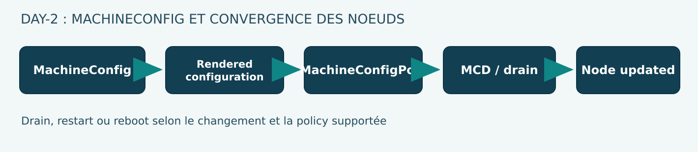

# 05 — RHCOS, Ignition, Machine Config Operator et opérations Day-2

**Volume 02 · DRAFT · Version : OpenShift Container Platform 4.22**  
**Objet : comprendre la gestion déclarative des systèmes de nœuds sans dérive SSH.**

## 1. Trois temps dans la vie d'un nœud

Une plateforme OpenShift doit traiter la création, la mise en service, la maintenance et le remplacement des nœuds. Trois mécanismes se distinguent :

1. **Provisionnement machine** : l'infrastructure fournit un hôte, des disques, une identité réseau et les conditions de boot.
2. **Ignition** : au premier boot, configure certains éléments de base requis par le système.
3. **Machine Config Operator (MCO)** : gère ensuite l'évolution supportée de paramètres de système et les changements de configuration des nœuds appartenant à des pools.

Ne pas confondre Machine API (gestion des Machines selon la plateforme), MachineConfig (description d'une configuration OS), MachineConfigPool (groupe de nœuds devant converger), et ressource MachineConfiguration (configuration singleton de l'Operator MCO pour certains comportements, dont node disruption policy).

## 2. Architecture de configuration

~~~mermaid
flowchart TD
  MC1[MachineConfig base] --> RENDER[Render controller]
  MC2[MachineConfig rôle] --> RENDER
  MCP[MachineConfigPool] --> RENDER
  RENDER --> R[Rendered MachineConfig]
  R --> MCD[Machine Config Daemon]
  MCD --> N1[Noeud A]
  MCD --> N2[Noeud B]
  CO[Machine Config Operator] --> MCP
  MCP --> STAT[Conditions Updated/Updating/Degraded]
~~~

La représentation est pédagogique. L'implémentation réelle combine plusieurs contrôleurs, agents et ressources. Les MachineConfigs sont assemblées selon des règles de priorité et de sélection documentées.

### 2.1 Un nœud, un seul MachineConfigPool d'appartenance

Un nœud peut posséder plusieurs labels de rôle, mais il ne doit appartenir qu'à un seul MachineConfigPool. Des pools personnalisés permettent de gérer certains ensembles d'ouvriers, par exemple des matériels spéciaux. Les MachineConfigs de base destinées aux workers peuvent être réutilisées dans des pools personnalisés, sous les règles de precedence applicables à la version.

Il faut vérifier les sélecteurs et l'héritage réel avant de proposer une MachineConfig. Une mauvaise sélection peut toucher beaucoup plus de machines que prévu.

## 3. Que peut gérer MCO ?

Red Hat documente la gestion déclarative de configurations liées notamment à :

- fichiers de système et unités systemd;
- paramètres du kernel et de NetworkManager;
- composants kubelet et CRI-O;
- configuration du runtime système;
- aspects de SSH et registries;
- certaines formes de layering RHCOS selon les possibilités/version.

Ces changements peuvent affecter tous les workloads hébergés par le nœud. Une modification de configuration ne doit jamais être traitée comme un simple edit de ConfigMap d'application.

## 4. Cycle de rollout d'une nouvelle configuration

Pour de nombreuses modifications, le MCO :

1. produit une nouvelle rendered MachineConfig;
2. sélectionne les nœuds concernés par le pool;
3. cordonne les nœuds, limitant le nouveau scheduling;
4. draine des workloads conformément aux politiques applicables;
5. applique les modifications;
6. redémarre si le changement l'exige;
7. vérifie l'état convergé puis permet le scheduling.

Selon les paramètres et la nature des changements, toutes ces étapes ne sont pas toujours nécessaires. Les node disruption policies documentées en 4.22 peuvent modifier les actions attendues pour certaines modifications; les règles supportées ne doivent pas être extrapolées à tous les composants.

### 4.1 maxUnavailable et sécurité de quorum

Le comportement de `maxUnavailable` varie selon le pool, sa configuration effective, sa taille et la documentation de la version. Le processus de mise à jour doit préserver le quorum etcd et éviter d'indisponibiliser plusieurs membres critiques. **Ne pas supposer une valeur universelle de 1 pour tous les pools**; lire `spec.maxUnavailable` et les règles documentées du MCP concerné.

**Anti-pattern :** augmenter brutalement maxUnavailable sur les masters pour accélérer un upgrade. Les gains de temps apparents ne compensent pas la perte possible du control plane. Pour une topologie critique, ce paramètre doit suivre strictement les recommandations de la plateforme.

### 4.2 PDB et capacité de remplacement

Un drain volontaire peut être bloqué par un PodDisruptionBudget lorsque le nombre de replicas disponibles ne satisfait pas le budget. Il faut examiner la disponibilité métier, la capacité restante, les zones, les policies et la cause du blocage; supprimer le PDB pour « terminer » la maintenance est une décision risquée.

## 5. MachineConfig vs MachineConfiguration : distinction obligatoire

Sur les versions qui exposent les node disruption policies, une ressource nommée **MachineConfiguration** configure le comportement du MCO; la ressource **MachineConfig** définit ce qui sera appliqué à un pool de nœuds.

| Objet | Responsabilité |
|---|---|
| MachineConfig | Changements au système/nœuds ciblés |
| MachineConfigPool | Sélection, version rendue, statut du groupe |
| MachineConfiguration (singleton) | Certains paramètres du MCO, dont nodeDisruptionPolicy |
| Node | Conditions Kubernetes, capacité et informations d'exécution |
| ClusterOperator machine-config | Santé globale rapportée par le composant |

Les node disruption policies peuvent demander, selon le changement, None, Drain, Restart, Reload, DaemonReload ou Reboot. Des modifications exigent malgré tout un reboot. La politique n'est pas un mécanisme pour contourner une intervention structurelle nécessaire.

### 5.1 Danger des node disruption policies

Red Hat précise que le MCO valide la **forme** de la policy, mais ne certifie pas que le résultat appliqué est fonctionnel. L'auteur demeure responsable d'un test supporté. Une policy qui évite un reboot au mauvais moment peut laisser le nœud dans une configuration incohérente.

La documentation signale en outre des limitations avec les images RHCOS personnalisées construites par on-cluster layering. Vérifier la compatibilité exacte avant de généraliser ces mécanismes.

## 6. Diagnostic read-only

~~~bash
oc get machineconfigpools
oc get machineconfigs
oc get nodes -o wide
oc get clusteroperator/machine-config
oc describe machineconfigpool worker
oc describe machineconfigpool master
~~~

Les noms master/worker sont les pools usuels mais peuvent différer de la topologie installée. Sur SNO/CRC, ne pas interpréter le nombre de nœuds ou leur rôle comme un cluster de production.

On veut notamment vérifier :
- pool Updated/Updating/Degraded;
- compteur de machines prêtes/updated;
- version de rendered config désirée et appliquée;
- nœud affecté, conditions, Events;
- cause de panne : drain, registre, reboot, modification système, daemon.

L'API peut montrer une évolution sans que chaque machine ait terminé son reboot. Ne pas éditer arbitrairement le label d'un nœud ou sa MachineConfig pour réduire artificiellement un compteur Degraded.

## 7. Cas N3 : changement système et nœud Degraded

**Situation fictive :** une nouvelle MachineConfig modifie un fichier système. Un worker ne rejoint pas Updated et reste Degraded.

Hypothèses :
1. un drain de workloads est bloqué;
2. une ressource systemd attendue n'existe pas;
3. une erreur de syntaxe/instruction rend la config invalide;
4. le nœud n'a plus accès au registre ou aux services requis;
5. une opération de reboot ne se déroule pas correctement;
6. un composant système ne redémarre pas.

Protocole :
- enregistrer la version désirée du pool;
- identifier le nœud affecté et la raison de dégradation;
- comparer la MachineConfig ciblée à la version préexistante;
- consulter les traces du MCO/MCD **via les circuits supportés et autorisés**;
- déterminer si l'opération est réversible ou nécessite un support incident.

**Ne pas** désactiver l'application des MachineConfigs, arrêter le daemon ou supprimer des pods de système comme remède improvisé.

## 8. Mise à jour et stratégies de production

Une opération de mise à jour doit coordonner :
- santé initiale du control plane;
- backup etcd compatible;
- capacité workload et PDB;
- domaines de panne et nombre de nœuds par pool;
- monitoring des services critiques;
- connexions au registry;
- accès réseau et certificats;
- capacité à isoler puis remplacer un nœud.

Le rollback d'une application GitOps n'est pas équivalent à un downgrade RHCOS ni à un rollback de version OCP. Les procédures de support diffèrent.

## 9. Architecture adaptée au CRC

Un CRC mono-nœud héberge plusieurs rôles sur un seul domaine de panne; il ne peut pas prouver un drain tolérant à la panne d'un worker physique indépendant. Il convient parfaitement à **l'observation read-only** des ressources MachineConfigPool, ClusterOperators et Nodes si l'utilisateur dispose des droits et si le CRC est suffisamment sain.

Sur un CRC sous pression RAM/disque, ne jamais appliquer une modification MCO pour un simple exercice : risque de reboot et perte temporaire de tous les POCs.

## 10. Questions de revue

1. Quelle différence entre Ignition et MCO ?
2. Un nœud peut-il appartenir à deux MachineConfigPools ?
3. Pourquoi rendered MachineConfig est-elle déterminante ?
4. Quel rôle joue un PDB pendant un drain ?
5. La valeur maxUnavailable=1 garantit-elle l'absence d'incident ?
6. Une node disruption policy supprime-t-elle toutes les nécessités de reboot ?
7. Comment différencier Degraded côté MCO et un problème de scheduler ?
8. Pourquoi un changement SSH manuel n'est-il pas un mode d'exploitation durable ?

## Sources

- [Red Hat — Machine configuration overview OCP 4.22](https://docs.redhat.com/en/documentation/openshift_container_platform/4.22/html/machine_configuration/machine-config-index)
- [Red Hat — Node disruption policies OCP 4.22](https://docs.redhat.com/en/documentation/openshift_container_platform/4.22/html/machine_configuration/mco-update-boot-skew-mgmt)
- [Red Hat — Understanding OpenShift Updates](https://docs.redhat.com/en/documentation/openshift_container_platform/4.22/html/updating_clusters/understanding-openshift-updates-1)
- [Red Hat — Architecture](https://docs.redhat.com/en/documentation/openshift_container_platform/4.22/html/architecture/architecture)

**Validation manquante :** contrôle de comportement sur des nœuds indépendants et exécution du change management. Aucune action CRC.

## 11. Approfondissement : render, déploiement et configuration divergente

La rendered MachineConfig matérialise l'état attendu pour un pool. Une MachineConfig ne se traduit pas nécessairement en mise à jour immédiate de tous les nœuds : les pools limitent le nombre de machines temporairement indisponibles, et les changements système peuvent exiger drain, restart de service ou reboot.

Le traitement se schématise ainsi :

~~~mermaid
sequenceDiagram
  participant G as Git / change approuvé
  participant A as API OpenShift
  participant R as Render controller MCO
  participant P as MachineConfigPool
  participant D as Machine Config Daemon
  participant N as Noeud
  G->>A: MachineConfig change
  A->>R: Événement observé
  R->>P: Rendered config désirée
  P->>D: Convergence planifiée par pool
  D->>N: Drain / mise à jour / reboot si requis
  D-->>P: État actuel, Updated ou Degraded
~~~

Cette séquence est une abstraction pédagogique. Les mécanismes Kubernetes et MCO réalisent les étapes exactes et les actions varient selon la modification et la politique Day-2.

### 11.1 Une divergence SSH peut ne pas être corrigée automatiquement

Le MCO gère les fichiers et paramètres couverts par les MachineConfigs. Une modification manuelle d'un fichier **géré** peut provoquer du drift détecté. En revanche, Red Hat indique que des modifications manuelles de fichiers qui ne sont **pas** gérés par MCO ne seront pas nécessairement écrasées. Il est donc inexact de croire que le MCO remet systématiquement à zéro tout changement sur le disque.

Le bon contrat de maintenance décrit explicitement la propriété de chaque fichier système, la source de vérité et la méthode de vérification de conformité.

### 11.2 Le piège de maxUnavailable

La valeur effectivement appliquée dépend de la configuration du MachineConfigPool et des règles de défaut du produit. La documentation Day-2 OpenShift 4.22 décrit le batching des workers et une valeur de défaut de **un worker ou 33 % du pool, selon la plus petite** pour le cas documenté. Ne pas généraliser ce résultat à toutes les topologies et catégories de pool : interroger la valeur réelle et les Conditions.

~~~bash
oc get machineconfigpools
oc get mcp worker -o jsonpath='{.spec.maxUnavailable}{"\n"}'
oc describe machineconfigpool worker
~~~

Une absence de champ dans une réponse API ne signifie pas forcément un défaut zéro; inspecter les règles officielles et le comportement du contrôleur.

## 12. Matrice de changement OS et interruption

| Changement | Risque dominant | Tests nécessaires |
|---|---|---|
| Fichier de CA | Trust des API/registries | TLS, downloads, dépendances |
| Registry configuration | Image pull du nœud | ImagePull et rollback de config |
| Unité systemd | Restart service / stabilité OS | Service actif après restart/reboot |
| Paramètre kernel | Comportement hôte et compatibilité | Drivers, volumes, sécurité |
| Kubelet config | Admission/resources et lifecycle | Probes, scheduling, santé du nœud |
| Node disruption policy | Évitement inapproprié d'une action | Tests de reload/restart et invariants |

Sur OCP 4.22, les node disruption policies permettent de définir les actions liées à certains changements, mais ne remplacent pas une qualification de la configuration. Un changement combiné qui nécessite reboot n'est pas rendu sans risque par une policy None.

## 13. Diagnostic N3 : MachineConfigPool Degraded

Séquence read-only :

1. relever le nom du pool et sa rendered configuration;
2. identifier le nombre de machines Ready/Updated/Degraded;
3. vérifier quel nœud échoue, sa phase et son dernier changement;
4. observer si le drain est bloqué par un PodDisruptionBudget;
5. examiner une dépendance au registre, au réseau ou à la configuration systemd;
6. mesurer les impacts sur le trafic métier et la capacité survivante;
7. documenter les conditions et les horaires;
8. obtenir une procédure de correction supportée avant toute mutation.

L'option de supprimer un MachineConfigPool ou une rendered MachineConfig pour réinitialiser l'état est interdite dans un atelier pédagogique : l'effet de bord sur les nœuds peut être majeur.

## 14. Cas d'architecture : capacité pendant maintenance

Cluster fictif avec six workers répartis en deux zones, chacun recevant des Pods critiques. Un MCP ne met à jour qu'un nœud à la fois. Cela ne garantit pas l'absence d'indisponibilité : un PodDisruptionBudget peut bloquer le drain, un volume peut être zonal et la capacité de l'autre nœud peut être saturée par les requests.

La revue d'architecture doit donc calculer :
- les replicas disponibles **avant** la maintenance;
- la perte temporaire possible dans chaque zone;
- la capacité réelle de replacement selon requests et affinités;
- le temps d'arrêt/reboot et la capacité du runtime à récupérer;
- l'impact sur les SLI clients.

Le résultat est une proposition de test sur un environnement multinœud autorisé, jamais une preuve de HA sur CRC mono-nœud.

## Références d'approfondissement

- [Red Hat — MachineConfig / MachineConfigPool 4.22](https://docs.redhat.com/en/documentation/openshift_container_platform/4.22/html/machine_configuration/machine-config-index)
- [Red Hat — Day-2 worker batching](https://docs.redhat.com/en/documentation/openshift_container_platform/4.22/html/postinstallation_configuration/day-2-operations-for-openshift-container-platform-clusters)
- [Red Hat — Node disruption policies](https://docs.redhat.com/en/documentation/openshift_container_platform/4.22/html/machine_configuration/mco-update-boot-skew-mgmt)
