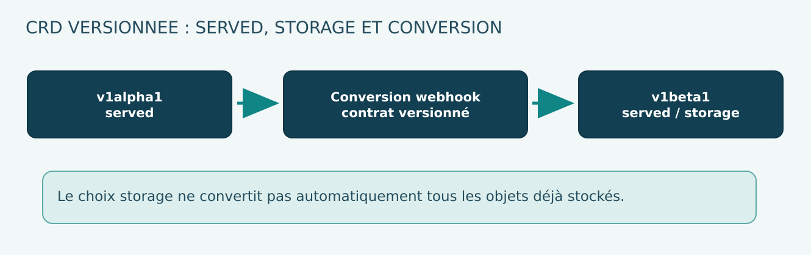

# 08 — API extensions : CRD, conversion, versionnement et contrats des Operators

**Volume 02 · DRAFT · Kubernetes/OpenShift 4.22.**  
**But : concevoir une API Kubernetes extension sans casser ses consommateurs lors des upgrades.**

## 1. La promesse d'une CustomResourceDefinition

Une **CustomResourceDefinition (CRD)** ajoute un type d'objet à l'API Kubernetes. Elle crée un contrat que peuvent consommer des utilisateurs, des contrôleurs et des pipelines GitOps.

Exemple : un objet CapabilityConsumption pourrait exprimer l'intention d'une application de consommer des services mutualisés (réseau, identité, observabilité). Le contrôleur associé lit cette intention, crée ou ajuste les ressources et publie un statut compréhensible.

La CRD **n'implémente pas** la logique de reconcile. Elle donne la forme et les capacités d'exposition de l'API; le contrôleur implémente le comportement.

## 2. Trois contrats à ne pas confondre

- **Schema** : champs, types, champs requis, validations, valeurs par défaut.
- **Behavior** : ce que le contrôleur fait pour atteindre la spec, y compris erreurs, ownership et suppression.
- **Status** : ce qu'il observe et comment il l'explique.

Un schema valide sans comportement stable n'est pas une API fiable. Inversement, un contrôleur sophistiqué sur une CRD permissive peut accepter des ressources indéfendables.

### Exemple de shape logique

~~~yaml
apiVersion: platform.example.invalid/v1alpha1
kind: CapabilityConsumption
metadata:
  name: web-team
  namespace: app-team
spec:
  profile: standard
  network:
    defaultDeny: true
  observability:
    enabled: true
~~~

Ce fragment n'est pas déployable sans CRD et contrôleur; le domaine example.invalid indique une illustration indépendante.

## 3. L'importance du Structural Schema

Une CRD versionnée doit spécifier un schéma OpenAPI structurel lorsque requis par l'API cible. En particulier :
- object avec properties explicites;
- propriétés scalaires correctement typées;
- tableaux dotés d'un contrat sur les éléments;
- validations cohérentes avec les évolutions prévues;
- champs inconnus traités explicitement;
- permissions et secrets jamais validés par regex seuls.

Les validations schema ne remplacent pas les validations relationnelles ni les contrôles d'autorisations métier, qui peuvent nécessiter un webhook ou une logique de reconcile. Les règles CEL disponibles varient selon version et limitations de l'API; vérifier la documentation exacte avant de choisir une expression.

## 4. spec et status : séparation de propriété

La spec est l'intention définie par l'utilisateur ou par GitOps. Le status est la représentation de l'état observé par le contrôleur. Éviter qu'un Operator écrive continuellement dans spec pour la « corriger » : il risque de provoquer du drift avec Argo CD et de supprimer la distinction entre commande et mesure.

Contrat typique de Conditions :
- Ready : l'objet satisfait-il le contrat opérationnel ?
- Progressing : une action est-elle en cours ?
- Degraded : l'objet est-il bloqué par une erreur ?

Ces noms ne sont pas universellement imposés. Définir pour chaque condition un type, status, reason, message, observedGeneration quand pertinent, et le comportement pendant la transition.

### 4.1 Fraîcheur de génération

Si metadata.generation=8 et status.observedGeneration=7, le status décrit une intention antérieure. Un tableau de bord ne doit pas considérer Ready=True comme preuve pour la génération 8 tant que la propriété de fraîcheur n'est pas établie.

## 5. Versions served et storage

Une CRD peut exposer plusieurs versions d'API, chacune ayant des propriétés :
- **served** : version accessible par les clients;
- **storage** : version utilisée pour la représentation persistante des ressources.

Il faut distinguer l'ajout d'une nouvelle version servie, son passage en version de stockage et la migration réelle des objets existants. Une évolution de schema ou de nom d'un champ ne se traite pas uniquement par le changement de chaîne v1alpha1 → v1beta1.

### Stratégie de versionnement

1. Documenter les consommateurs (GitOps, clients, autres Operators).
2. Ajouter une version nouvelle, avec compatibilité et conversion documentées.
3. Choisir la version de storage et les transitions supportées.
4. Assurer que les anciennes ressources restent lisibles.
5. Éviter d'enlever une version servie tant qu'elle est utilisée.
6. Traiter storageVersions et données stockées avant suppression définitive.
7. Exécuter des tests d'upgrade/downgrade **applicatifs** (pas downgrade OpenShift) avec des ressources existantes.

## 6. Webhook de conversion : valeur et risque

Lorsque deux versions d'une ressource ne sont pas convertibles automatiquement selon les règles applicables, un conversion webhook peut traduire l'objet entre formes. Cela ajoute une dépendance de disponibilité, de sécurité TLS et de compatibilité à l'API.

**Piège :** si le service de conversion devient indisponible, certaines opérations LIST/GET/UPDATE peuvent échouer. Un changement d'Operator qui casse le webhook peut empêcher l'Operator lui-même de récupérer ses CRs.

La procédure de livraison doit inclure un bootstrap et une stratégie de reprise : service/certificat accessibles **avant** de rendre indispensable la version convertie.

## 7. Finalizers et suppression maîtrisée

Un finalizer empêche la suppression complète de l'objet pendant le nettoyage contrôlé. Il est approprié lorsqu'une ressource externe doit être traitée, mais peut devenir un obstacle en cas de dépendance perdue.

Contrat proposé :

| Situation | Conduite |
|---|---|
| CR avec suppression demandée | Contrôleur observe deletionTimestamp |
| Ressource externe supprimable | Supprimer de manière idempotente puis retirer finalizer |
| Politique Retain | Conserver la ressource et enregistrer la décision |
| Ressource externe indisponible | Retry borné, Condition et procédure d'incident |
| Suppression forcée manuelle | Exception supportée, audit, connaissance des conséquences |

La suppression d'un finalizer sans comprendre l'impact peut laisser des volumes, files, comptes ou droits orphelins.

## 8. Server-Side Apply et managedFields

SSA suit la propriété de champs via managedFields. Le contrôleur doit posséder les champs qu'il est responsable de réconcilier, pas les annotations ou valeurs d'un autre controller.

Exemple : GitOps déclare une CapabilityConsumption; l'Operator crée un Deployment et un Service. Si GitOps impose aussi l'image du Deployment, les deux systèmes peuvent entrer en conflit. Choisir un contrat de propriété :

- GitOps possède CR.spec et l'ensemble de ses champs déclaratifs.
- L'Operator possède les champs pertinents de Deployment/Service dérivés.
- L'Operator publie CR.status.
- Une politique de suppression/retention est documentée et testée.

L'option force-conflicts n'est pas une solution architecturale par défaut : elle transfère une propriété de champ et peut provoquer une oscillation.

## 9. Tests de maturité d'une CRD

| Test | Cas | Invariant |
|---|---|---|
| Admission négative | Spec invalide | Objet rejeté sans privilège élargi |
| Premier reconcile | Ressources absentes | Créées avec ownerReferences exactes |
| Idempotence | Répéter reconcile | Pas de nouvelles mutations superflues |
| Conflit SSA | Champ possédé par un tiers | Erreur claire, pas de force automatique |
| Crash partiel | Première création OK, deuxième échoue | Reprise sans doublon |
| Validation de status | observedGeneration | Ready frais pour génération courante |
| Conversion | Ancienne CR | Lecture puis relecture sans perte de données |
| Suppression | Retain ou Delete | Ressources suivies et aucune suppression surprise |
| Upgrade Operator | Contrat CRD existant | Compatibilité testée avant release |

Un test offline de fonction Python peut vérifier une logique d'idempotence. Il ne suffit pas pour garantir admission/SSA/conversion sur Kubernetes : des tests envtest/Kind ou clusters de test sont nécessaires.

## 10. ADR d'une API de plateforme

**Contexte :** proposer à des équipes produit un service en self-service qui crée des capacités de réseau et de télémétrie.

**Décision de référence :** offrir une CRD versionnée, des profils explicites, un service account minimal, un reconcile SSA idempotent et des Conditions observables. Les changements sensibles (NetworkPolicy, Secrets, quotas) ne sont pas déclenchés depuis un champ texte libre non validé.

**Conséquences :** dépendance à la compatibilité des APIs, support des anciennes ressources, montée en version du controller, gestion des finalizers et stabilité des schémas.

## 11. Questions de soutenance

1. Quelle différence entre CRD et Operator ?
2. Pourquoi le sous-objet status doit-il avoir son propre contrat ?
3. Quels risques à convertir une CR v1alpha1 vers v1 ?
4. À quoi sert storage=true ?
5. Quelle panne provoque un webhook de conversion inaccessible ?
6. Pourquoi SSA nécessite-t-il des règles d'ownership ?
7. Quand garder un finalizer plutôt que le supprimer ?
8. Quelles preuves permettent de déclarer une API de CRD versionnée stable ?

## Sources

- [Kubernetes — Extend Kubernetes API with CRDs](https://kubernetes.io/docs/tasks/extend-kubernetes/custom-resources/custom-resource-definitions/)
- [Kubernetes — API versioning](https://kubernetes.io/docs/reference/using-api/#api-versioning)
- [Kubernetes — Server-Side Apply](https://kubernetes.io/docs/reference/using-api/server-side-apply/)
- [Kubernetes — API conventions](https://github.com/kubernetes/community/blob/master/contributors/devel/sig-architecture/api-conventions.md)
- [Red Hat — OpenShift 4.22 Operators](https://docs.redhat.com/en/documentation/openshift_container_platform/4.22/html/operators/understanding-operators)

**Statut :** exemple de conception, non validé sur cluster.

## 12. Exemple de migration d'une API de plateforme versionnée

Imaginons que la version v1alpha1 d'une CRD comporte un booléen observability.enabled, tandis que la version v1beta1 remplace ce contrat par un champ profile contenant standard, enhanced ou disabled. Le changement n'est **pas** un simple renommage : il faut définir le mapping fonctionnel et les valeurs par défaut.

### 12.1 Matrice de conversion sur papier

| Entrée v1alpha1 | Sortie v1beta1 proposée | Point à confirmer |
|---|---|---|
| enabled=true | profile=standard | Niveau standard est-il équivalent ? |
| enabled=false | profile=disabled | Les ressources existantes doivent-elles être retirées ? |
| Champ absent | Profile par défaut explicite | Ancienne version permettait-elle l'absence ? |
| enabled=true avec option avancée | profile=enhanced | Information conservée sans perte ? |

Une migration doit préserver les informations pertinentes. Si une conversion aller-retour supprime un champ, un opérateur peut écraser silencieusement des données de configuration lorsqu'il écrit l'objet. Des tests avec fixtures d'objets existants sont nécessaires.

### 12.2 storage et served : transitions coordonnées

Le processus comprend :
1. exposer la nouvelle version served en parallèle de l'ancienne;
2. mettre en place la conversion si les représentations divergent;
3. vérifier que chaque version est sérialisable et correctement validée;
4. définir la nouvelle version de storage lorsqu'elle est prête;
5. migrer les objets réellement stockés selon la procédure supportée;
6. vérifier le statut des versions stockées;
7. retirer l'ancienne version served seulement lorsque tous les clients l'ont abandonnée.

La version storage désignée ne signifie pas que **toutes** les anciennes ressources ont déjà été réécrites dans cette version. D'où le besoin d'inspecter storedVersions et d'employer une migration adaptée.

## 13. Conversion webhook et bootstrap circulaire

Un conversion webhook est appelé pour traduire des objets entre formes. Sa disponibilité et son certificat influencent l'accès aux CRs. Si un upgrade supprime ou dégrade le Service de conversion avant que le nouveau contrôleur ait démarré, certains LIST/GET peuvent échouer. Il faut un protocole de livraison sans dépendance circulaire.

Architecture saine :
- service webhook disponible avant changement de stratégie de conversion;
- certificat et CA valides et renouvelables;
- tests de compatibilité anciens objets;
- disponibilité et latences surveillées;
- séquence de décommissionnement d'ancienne version traçable;
- procédure de récupération qui ne nécessite pas de lire des objets impossibles à convertir.

## 14. Idempotence des contrôleurs et propriété des champs

Une CR déclarée dans GitOps possède un auteur logique. L'Operator construit des ressources filles et publie status. Deux sources de vérité simultanées pour les mêmes champs entraînent des conflits SSA et éventuellement une oscillation de reconciliation.

Définir explicitement :

| Ressource/champ | Gestionnaire autorisé | Politique |
|---|---|---|
| CR.spec | GitOps / auteur du contrat | Changement approuvé |
| CR.status | Operator | Jamais une commande métier |
| Deployment.spec.image dérivé | Operator | Converge depuis CR |
| Annotations d'observabilité non détenues | Gestionnaire autorisé distinct | Ne pas écraser |
| Secret externe | Provider de secrets | Pas de valeur en clair dans CR |
| Ressource supprimée | Finalizer + deletionPolicy | Retain/Delete expliqué |

### 14.1 observedGeneration et risque de statut périmé

Une Condition Ready=True obtenue pour generation=5 n'est pas un résultat valide pour spec generation=6. Le contrôleur doit publier une observation fraîche quand la génération change, y compris lorsqu'un échec partiel rend certaines ressources filles indisponibles.

Un tableau de bord qui filtre uniquement Ready=True sans examiner observedGeneration peut annoncer à tort un succès après modification de spec.

## 15. Tests de non-régression d'une CRD

Pour une API de plateforme destinée à plusieurs équipes :
- validation admission positive/négative;
- round-trip conversion v1alpha1 → v1beta1 → v1alpha1 sur des fixtures;
- conservation des champs définis comme invariants;
- upgrade du controller sur des objets déjà stockés;
- restauration après un crash entre deux créations d'objets;
- conflits SSA non écrasés;
- suppression Retain et Delete;
- mise à jour de status après une nouvelle generation;
- liveness d'un webhook et gestion de son indisponibilité.

Certains cas peuvent être vérifiés offline sur un modèle Python. Les preuves réelles de conversion/admission nécessitent un API server d'essai (par exemple envtest selon les capacités), des CRDs valides et les éléments d'infrastructure correspondants.

## 16. ADR : publier une nouvelle version

**Contexte :** une vingtaine d'équipes utilisent une CRD v1alpha1. Une version v1beta1 ajoute des validations strictes.

**Décision :** déployer en deux étapes avec double version servie, conversion fiable, tests de préproduction sur CRs existantes et contrôle des clients GitOps. La suppression de v1alpha1 est repoussée jusqu'au retrait complet de ses consommateurs.

**Conséquences :** coût de maintenance transitoire, risque webhook supplémentaire, mais migration contrôlable. Les preuves de tests de conversion sont attachées à la Pull Request et à la release de l'Operator.

## Sources d'approfondissement

- [Kubernetes — Custom Resource Definitions](https://kubernetes.io/docs/tasks/extend-kubernetes/custom-resources/custom-resource-definitions/)
- [Kubernetes — API Conventions](https://github.com/kubernetes/community/blob/master/contributors/devel/sig-architecture/api-conventions.md)
- [Kubernetes — Server Side Apply](https://kubernetes.io/docs/reference/using-api/server-side-apply/)
